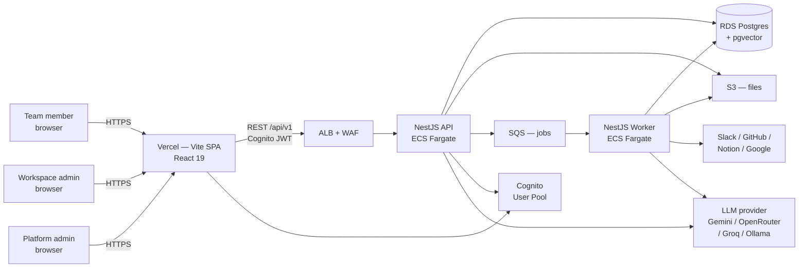
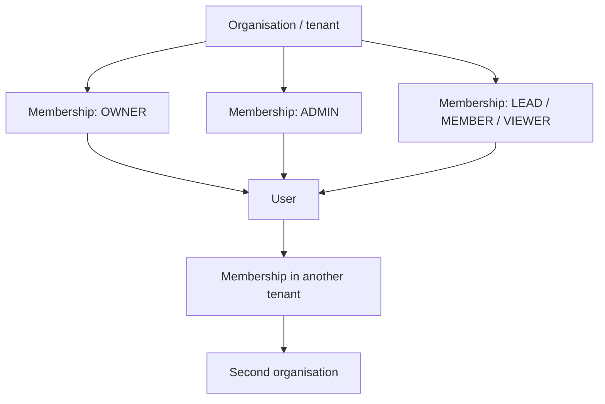
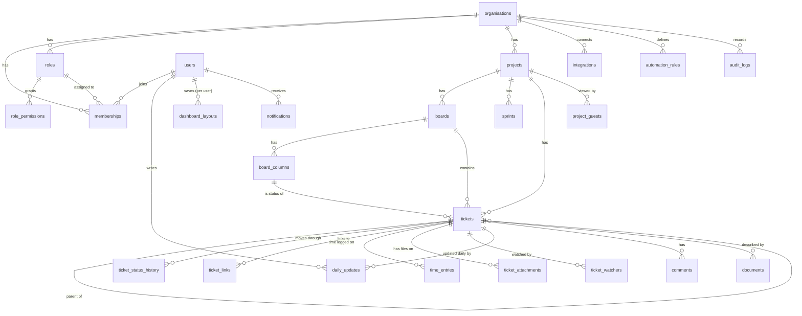
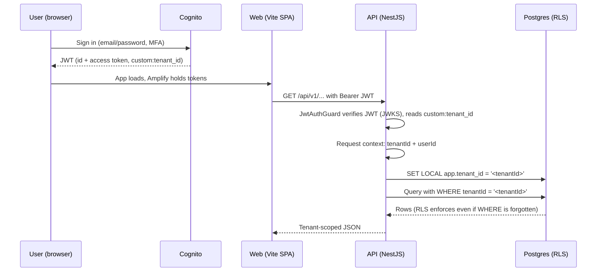
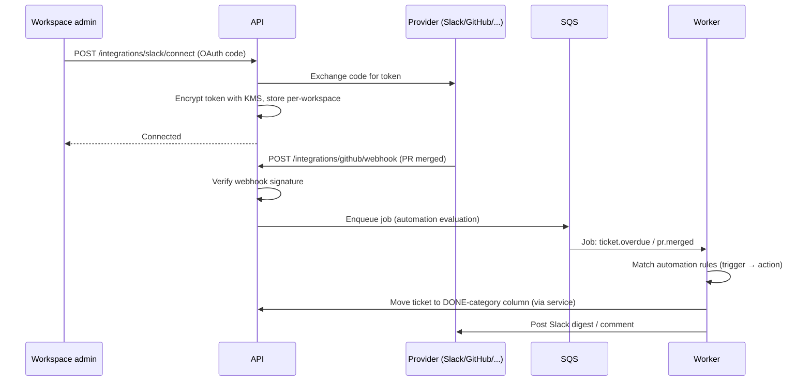
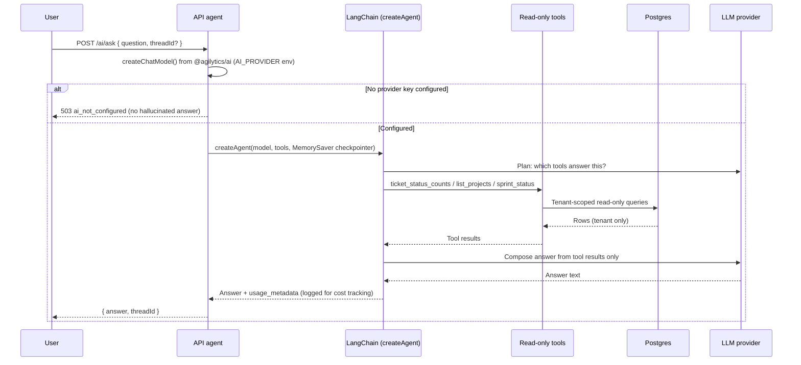

# Agilytics OS — System Design

> The end-to-end design of v2: what the system is, how data flows through
> it, and what each part owns. Architecture principles, trade-offs, and the
> extraction path live in [`ARCHITECTURE.md`](ARCHITECTURE.md); deep dives
> live in `docs/` (`FRONTEND.md`, `REALTIME.md`, `INTEGRATIONS.md`,
> `AI.md`, `WORKFLOWS.md`, `PRIVACY-BOUNDARY.md`). Locked decisions and
> open questions live in [`DESIGN-DECISIONS.md`](DESIGN-DECISIONS.md).

## 1. What the system is

Agilytics OS is an **AI-powered operating system for teams and project
management** — an internal tool for companies, not a public product. One
company = one tenant (organisation). Inside a tenant: projects, boards
with fully custom statuses, sprints with a Backlog, tickets (with epics,
subtasks, dependencies, time tracking), daily updates, project docs,
reporting, integrations, automations, and AI agents — without switching
tabs. **V1 is not a feature reference for v2** (see
`FEATURE-EVALUATION.md`, approved 2026-11-17): v1 was a bootcamp tool and
a Notion clone, not a PM tool. V2 is judged against Jira / ClickUp /
Linear / Plane + what companies asked for. A separate Platform Admin
Panel lets **us** run the SaaS platform (tenants, plans, health) with no
application-level access to a customer's business data
(see `docs/PRIVACY-BOUNDARY.md`).

### System context

## 2. Tenants, users, roles

- **Tenant = Organisation.** Every tenant-owned row carries `tenantId`.
  Tenants are isolated at the application layer (every query scoped) and
  at the database layer (Postgres RLS).
- **Users** live in Cognito; the `users` table holds profile data only.
  A user can belong to several tenants (one `Membership` per tenant).
- **Workspace roles are custom (decision 21, Phase 1).** A workspace
  has **Roles**, not a fixed enum. The five built-in roles — `OWNER` >
  `ADMIN` > `LEAD` > `MEMBER` > `VIEWER` — are **system roles**, seeded
  per workspace on workspace creation, with the permission sets in
  §2.1 below. A workspace admin (company head, **not** the platform
  admin) can create new roles with any free-text name, rename and
  delete custom roles, and toggle each role's permissions. Custom
  workflows without custom roles is half the story: a company that
  names its own statuses must also be able to name its own roles.
  A `Membership` references a `Role` (`roleId`); the legacy fixed
  `MemberRole` enum is kept only as a migration fallback (see schema).
- **Project-scoped guest role:** a `ProjectGuest` — an external viewer
  (e.g. a client stakeholder), read-only on **one** project, not a
  workspace role and not a `Role` row.
- **Platform roles** (separate axis): `PLATFORM_ADMIN` (manage tenants,
  plans, feature flags, health) and `PLATFORM_SUPPORT` (read-only,
  never impersonates). A platform admin is **not** a member of any
  tenant — see the privacy boundary.

### 2.1 Custom roles — permission catalog and enforcement

**Permission catalog.** The catalog is a fixed list of permission keys
(`PermissionKey` enum in the schema — deliberately an enum, not a
table: every key is referenced by a guard and by the Roles matrix UI,
so a free-text table could grant a permission no code ever checks).
Adding a permission is a code change: new enum value + migration +
guard use + matrix row. Keys are grouped by area:

| Area | Permission keys |
|---|---|
| Workspace, members, roles, teams | `workspace.view_settings`, `workspace.edit_settings`, `members.invite`, `members.remove`, `members.assign_role`, `roles.manage`, `teams.manage`, `billing.view`, `billing.manage` |
| Projects | `projects.create`, `projects.edit`, `projects.delete`, `projects.view_all` |
| Boards / workflows | `boards.create`, `boards.manage_workflow` |
| Tickets | `tickets.create`, `tickets.view_all`, `tickets.edit_own`, `tickets.edit_any`, `tickets.delete`, `tickets.assign`, `tickets.move_status`, `tickets.comment`, `tickets.attach` |
| Sprints | `sprints.create`, `sprints.manage` |
| Daily updates | `daily_updates.create_own`, `daily_updates.view_all`, `daily_updates.edit_any` |
| Project Docs | `docs.create`, `docs.edit_any`, `docs.delete` |
| Reporting | `reporting.view`, `reporting.view_all`, `reporting.export` |
| Integrations, automations, import | `integrations.connect`, `integrations.disconnect`, `automations.manage`, `integrations.import` |
| AI | `ai.use`, `ai.manage_budgets` |
| Time tracking | `time.view_all` |

**Own vs any.** `*_edit_own` / `*_create_own` mean the member's own
work (a ticket they are assigned to or authored, their own daily
update); `*_edit_any` / `*_view_all` mean anyone's work in the
workspace. A member with only `tickets.edit_own` can edit a ticket
they are assigned to, never someone else's. `projects.view_all` /
`tickets.view_all` / `reporting.view_all` are the "see the whole
workspace" keys — without them a member sees only their own projects
and tickets (plus anything explicitly shared). There is no implicit
"admin can do everything" in code: even OWNER's powers come from its
granted keys (it is seeded with all of them).

**System-role defaults (seeded per workspace, editable afterwards).**
OWNER: all 42 keys. ADMIN: all except `billing.manage` (billing is
the OWNER's, unless the OWNER grants it) — ADMIN keeps
`roles.manage`, so an ADMIN can create roles but cannot take the
workspace's billing. LEAD: `projects.view_all`, `boards.create`,
`tickets.*` except `tickets.delete`, `sprints.create` +
`sprints.manage`, `daily_updates.view_all`, `docs.create`,
`reporting.view_all`, `ai.use`, `time.view_all`, plus
`members.invite` (no remove / assign-role), `teams.manage` (no
`roles.manage`). MEMBER: `tickets.create`, `tickets.edit_own`,
`tickets.move_status`, `tickets.comment`, `tickets.attach`,
`daily_updates.create_own`, `docs.create`, `reporting.view`,
`ai.use`, `integrations.connect` (own connections only — a member
connecting Slack for themselves is not a workspace connection).
VIEWER: `workspace.view_settings`, `projects.view_all`,
`tickets.view_all`, `daily_updates.view_all`, `reporting.view` —
read-only. These are **defaults**: a workspace admin may toggle any
of them afterwards, including on a system role. Seeding happens in
the workspace-creation transaction (5 roles + their grants), so a
workspace never exists without its roles.

**Enforcement — server-side, never client-side only.** Every mutation
goes through a `PermissionsGuard` + `@RequirePermissions(...)`
decorator that reads the caller's `Membership` → `Role` →
`RolePermission` rows for that tenant, in the request context
(tenantId + userId, set by the JWT guard). Deny by default: no row,
no permission. The frontend hides buttons it knows the user lacks,
but hiding is cosmetic — the API is the enforcement point, and the
same check runs for API clients, webhooks and worker jobs (the worker
acts with the system identity of the rule's workspace, never with a
user's permissions). Role/permission changes and member role
assignments are written to the append-only `AuditLog` (entity `Role`
/ `Membership`, with the before/after permission set in metadata).
Deleting a role in use is refused — reassign those members first.
Renaming a role never changes its id, so in-flight tokens and audit
rows stay valid.

## 3. Domain model

### 3.1 Projects, boards, custom statuses

- A **project** belongs to a tenant: `key` (e.g. `ENG` — ticket IDs are
  `ENG-123`), `leadId`, `startDate`/`targetDate`, `type`
  (`SOFTWARE` / `OPS` / `INTERNAL`), `status`. It has many **boards**
  (e.g. Engineering, Design, Ops). Project creation auto-creates a
  default board from the shared template (Backlog / To Do / In Progress
  / Review / Done).
- A **board** has unlimited **columns**. Column: free-text `name` (no
  restrictions), `order`, `colour`, a reporting `category`
  (`TODO` / `IN_PROGRESS` / `DONE`), and an optional **WIP limit**.
  **There is no fixed status enum.**
- A **ticket** references a board (`boardId`) and a column (`statusId`).
  A ticket with no column is **unplaced** — visible, never silently
  dropped from counts.
- **Status history** records every move: `fromStatusId`, `toStatusId`,
  `changedById`, `createdAt`. Only `TicketsService.changeStatus` writes
  it. Reporting (time-in-status, cycle time, velocity, reopen rate)
  reads categories + history, never column names.

### 3.2 Sprints and Backlog

A sprint belongs to a project: `name`, `goal`, `startDate`, `endDate`,
status (`PLANNED` / `ACTIVE` / `COMPLETED`), `capacity` (story points),
`retrospective` notes. Tickets attach to a sprint optionally. Velocity
is measured in story points entering a DONE-category column during the
sprint. The **Backlog** is the prioritised list of un-sprinted tickets —
the sprint-planning source. **Burndown** (points remaining per day) is
computed from status history. **Carry-over** moves incomplete tickets
to the next sprint in one action.

### 3.3 Tickets

Ticket: `key` (e.g. `ENG-123`, the primary human identifier), `type`
(`EPIC` / `STORY` / `TASK` / `BUG`), `parentId` (subtask → parent,
story → epic — epic progress rolls up from children in a
DONE-category column), `title`, `description`, `priority`
(`LOW` / `MEDIUM` / `HIGH` / `URGENT`), `estimate` (story points),
`assignee`, `dueDate`, `labels`, `customFields` (JSON, per project),
`watchers`, `boardId`, `statusId`, `sprintId`. Plus comments
(discussion, with @mentions), status history (record), **attachments**
(S3, on the ticket), and **links** (`TicketLink`: BLOCKS / BLOCKED_BY /
RELATES_TO / DUPLICATES — a blocked badge on the board, blockers listed
on the ticket). Comments are **not** a source for reporting. Tickets
are shown in **List / Table view as well as Board view**, with bulk
edit + saved filters.

### 3.4 Daily updates and My Work

One row per **member per ticket per day** (upsert on
`[ticketId, memberId, date]`): `doneToday`, `next`, `blockers`,
`hasBlocker`, `progressPercent`, `health` (`ON_TRACK` / `AT_RISK` /
`BLOCKED`), `timeSpentMin`. **Burden control:** the composer is a
2-minute form, pre-filled from yesterday + linked GitHub activity.
`timeSpentMin` writes to `TimeEntry` (one source, not two). Daily
updates — not comments — feed:

- the **Today feed** (who updated / who is silent / open blockers),
- **My Work** (top of Home: assigned to me, due today/overdue, blocked,
  mentioned, my updates due) and a **per-person day view** (one person's
  updates across their tickets today),
- **silent / stale tracking** (not done + no update in 3+ days — the
  honest name for the old "quiet-member detection"),
- **per-person tracking** and **progress/velocity trends**.

**Home is Today / My Work first** — not a social feed. There is no
activity-feed-as-social-feed shape in v2.

### 3.5 Project Docs (not a wiki)

Documents are **Project Docs**: they live under a project (or a ticket /
sprint), with a PM template (PRD, spec, sprint plan, retro) and version
history, and link to the tickets they describe. Files go to S3 via
presigned upload URLs (bytes never proxied through the API). There is
no standalone Doc Hub wiki, no global docs library, no separate docs
homepage. Notion docs can be linked/embedded via the Notion integration
— that is the escape hatch for teams that already live in Notion,
instead of rebuilding Notion. Editor: Tiptap may stay, but only if it
is the best PM-doc editor on merit — "same as v1" is not a justification
(see DECISION-SHEET Q12, re-decided on approval of the rework).

### 3.6 Reporting

The dashboard summary aggregates, per tenant: KPI cards (active
projects, tickets done, velocity points, at-risk members, overdue
tickets), velocity (points entering DONE per week), **sprint burndown**,
**time-in-status** (from status history), throughput, WIP, member
workload (active tickets, completed points, status), and the Today feed
(updated/silent/blockers/stale). **Health badges** (ON_TRACK / AT_RISK /
NEEDS_ATTENTION) are computed from Daily Updates + blockers + stale,
with the rule written down — never template sentences. The dashboard
has a **My Work strip on top**. All aggregates read column categories
and history — custom column names never break a report. **Weekly
reports are generated, shareable reports** (live data → email / Slack /
PDF export, scheduled by the worker). There is **no slide-deck
builder** — it was cut in the feature rework.

**Customisable dashboard + UI (Phase 1, decision 20).** Every
dashboard card is a widget from a registry (KPI card, velocity chart,
workload donut, Today feed, blockers, at-risk list, My Work, AI
brief). Per user: add/remove widgets, drag to rearrange, resize
width/height on a grid; each widget's stats, project/sprint/team
scope and time range are configurable in a config panel. Layouts are
saved per user (`DashboardLayout`), auto-saved, synced across
devices, resettable in one click, and seeded from role templates
(Manager / Lead / Developer / Viewer). UI customisation is per user
too: density (comfortable/compact), sidebar collapsed/expanded,
visible nav items — stored in the layout record's `ui` block. The
Agibankz theme is fixed; users do not pick colours/skins.
Customisation is per **user**, not per workspace — the company's
workflow stays shared, the view is personal. The reporting engine
underneath never changes, so a custom dashboard can never break a
report: widgets read the same aggregates as the fixed dashboard and
the generated weekly reports, and a widget whose scope is deleted
falls back to an empty state.

### 3.7 Notifications and Inbox

**Notification Inbox (Phase 1):** one list, read/unread, filter by
mention / assignment / blocker / automation — the notification home.
Phase 1 also has TanStack Query polling + an SSE-ready stub
(`GET /notifications/stream` returns 501). Phase 2: WebSocket gateway
with tenant-scoped rooms, presence, typing, and notifications. Phase 3:
activity feed + live cursors. The **activity timeline** (Phase 2) is a
ticket/project timeline built from existing tables (status moves +
comments + updates + automation runs, newest first) — it is also the
stored form of the Phase 3 realtime feed. See `docs/REALTIME.md`.

### 3.8 Integrations

Tier 1 native first — **thin Slack + GitHub in Phase 1** (post to Slack,
link PRs, commit → ticket), Notion + Google Calendar/Gmail/Drive in
Phase 2. **Jira / ClickUp import in Phase 1** (projects, tickets,
statuses mapped to reporting categories, users, attachments). Tier 2
(Teams/Outlook, Figma, Linear, Zoom/Meet, Stripe), Tier 3 escape hatch
(webhooks, Zapier/Make, CSV). One provider = one file, same interface
(connect OAuth, disconnect, sync, webhook handler), registry-based.
OAuth tokens are KMS-encrypted, per-workspace. See
`docs/INTEGRATIONS.md`.

### 3.9 Automations

Rules are **trigger → action** (e.g. `ticket.overdue` → `slack.post`),
stored per workspace, evaluated by the worker, built in a **visual,
no-code builder** owned by the company, with a run log and a "test this
rule" action. See §7 and `docs/INTEGRATIONS.md`. The 5-step chain
(commit → done → Slack → pre-filled daily update → AI brief) is the
differentiator — Jira only does step 2.

### 3.10 AI agents

LangChain.js agents (tools, memory, multi-step), not single chat calls.
The API agent (`POST /ai/ask`) answers from real workspace data through
read-only tools. The worker runs long jobs (weekly summaries). Provider
is chosen by `AI_PROVIDER` env. **AI privacy rule: free tiers
(Gemini free, OpenRouter `:free`, Groq free) are for dev and demo data
only. Any pilot workspace with real client data runs on a paid,
no-retention provider (Gemini paid by default, $20/workspace/month
cap).** Cap enforcement is a Phase 3 gate. No key configured → 503,
never a hallucinated answer. Write/action tools arrive in Phase 3,
behind explicit per-action approval. See `docs/AI.md`.

### 3.11 Time tracking, Roadmap, activity

- **Time tracking (Phase 2):** `TimeEntry` (ticket, member, date,
  minutes, note), summed per ticket/sprint/project. Daily Update
  `timeSpentMin` writes to it. No invoicing.
- **Roadmap / Timeline / Calendar (Phase 2):** epics + sprints on a date
  axis, driven by sprint `startDate`/`endDate` and epic dates; Calendar
  view from due dates. Gantt with dependencies comes with ticket links.
- **Activity timeline (Phase 2):** ticket + project timelines from
  existing tables (see §3.7).

### 3.12 Admin panel (platform)

`/admin` in the web app + `GET /admin/*` in the API, guarded by
`PLATFORM_ADMIN`. It manages **tenant metadata** (organisations, users,
plans/feature flags, integrations, audit log, system health, security
settings) — never customer business data. See
`docs/PRIVACY-BOUNDARY.md`.

### 3.13 Custom roles and permissions (Phase 1, decision 21)

`Role` (tenant-scoped, free-text name, description, optional colour,
`isSystem` for the five seeded built-ins) + `PermissionKey` (fixed
catalog, §2.1) + `RolePermission` (the join — a grant is a row,
revoking is deleting it). A `Membership` points at a `Role`
(`roleId`); the legacy `MemberRole` enum is a migration fallback
only. **UI:** a **Roles & Permissions** settings page
(`/settings/roles`, workspace admin only — requires
`roles.manage`): a matrix with roles as columns, permissions as rows
grouped by area, toggles per cell, plus create/rename/delete role
actions. The matrix is the only place permissions are edited — there
is no per-member permission editing, which would drift from the
role. Role assignment happens on the member invite/edit screen
(role dropdown listing system + custom roles). The frontend reads the
caller's permissions from `GET /identity/me` (effective permission
set for the tenant) and hides actions the user lacks — cosmetic only;
the API guard enforces. Role/permission changes and assignments go
to the `AuditLog`. Deleting a role in use is refused; reassign
members first.

## 4. Database schema summary

Postgres (RDS) + `pgvector` (AI RAG). Every tenant-owned table has
`tenantId` and RLS enabled. Full DDL: `apps/api/prisma/schema.prisma`
+ `apps/api/prisma/migrations/20261117000000_init/migration.sql`.

| Table | Key columns | Key relations |
|---|---|---|
| `organisations` | `name`, `slug` | tenant root |
| `users` | `email`, `name` | — |
| `memberships` | `tenantId`, `userId`, `role` (legacy fallback), `roleId?` | unique (`tenantId`, `userId`) → `Role` (`roleId`, Restrict on delete); effective permissions from `Role` when set, else legacy role mapping |
| `roles` | `tenantId`, `name`, `description?`, `colour?`, `isSystem` | tenant root for roles; unique (`tenantId`, `name`); system roles seeded per workspace |
| `role_permissions` | `roleId`, `permissionKey` (`PermissionKey` enum) | join — a grant is a row; `@@id([roleId, permissionKey])` |
| `teams` / `team_members` / `team_projects` | `tenantId`, `name`, `leadId`, `description`, `capacity` | team ↔ user, team ↔ project |
| `projects` | `tenantId`, `key`, `name`, `leadId`, `startDate`, `targetDate`, `type`, `status` | → organisation; unique (`tenantId`, `key`) |
| `project_guests` | `tenantId`, `projectId`, `userId` | project-scoped external viewer; unique (`projectId`, `userId`) |
| `boards` | `tenantId`, `projectId`, `name`, `isDefault` | → project |
| `board_columns` | `boardId`, `name`, `order`, `colour`, `category`, `wipLimit?` | → board |
| `sprints` | `projectId`, `name`, `goal`, `startDate`, `endDate`, `status`, `capacity?`, `retrospective?` | → project |
| `tickets` | `projectId`, `sprintId?`, `boardId?`, `statusId?`, `key`, `type`, `parentId?`, `title`, `priority`, `estimate`, `assigneeId?`, `dueDate?`, `labels`, `customFields?` | → project, sprint, board, column, user, parent; unique (`projectId`, `key`) |
| `ticket_watchers` | `ticketId`, `userId` | → ticket, user |
| `ticket_attachments` | `ticketId`, `fileName`, `s3Key`, `uploadedById` | → ticket (S3 file on the ticket) |
| `ticket_links` | `fromTicketId`, `toTicketId`, `type` (BLOCKS / BLOCKED_BY / RELATES_TO / DUPLICATES) | → tickets |
| `time_entries` | `ticketId`, `memberId`, `date`, `minutes`, `note?` | → ticket, user; fed by DailyUpdate `timeSpentMin` |
| `notifications` | `userId`, `type`, `entity?`, `entityId?`, `title`, `isRead` | Notification Inbox |
| `ticket_status_history` | `ticketId`, `fromStatusId?`, `toStatusId`, `changedById?`, `createdAt` | → ticket, columns |
| `daily_updates` | `ticketId`, `memberId`, `date`, `doneToday`, `next`, `blockers`, `hasBlocker`, `progressPercent`, `health`, `timeSpentMin` | unique (`ticketId`, `memberId`, `date`) |
| `dashboard_layouts` | `userId`, `tenantId`, `name`, `layout` (JSON: widgets + `ui` block), `isDefault`, `template?` (MANAGER / LEAD / DEVELOPER / VIEWER) | → user, organisation; unique (`userId`, `tenantId`, `name`) — per-user custom dashboard, tenant-scoped, RLS |
| `comments` | `ticketId`, `authorId`, `body` | → ticket; @mentions notify |
| `documents` | `projectId?`, `ticketId?`, `sprintId?`, `template?`, `title`, `content` | Project Docs, not a wiki → project / ticket / sprint |
| `integrations` | `tenantId`, `provider`, `encryptedCredentials`, `isActive` | unique (`tenantId`, `provider`) |
| `automation_rules` | `tenantId`, `name`, `trigger`, `action`, `config`, `isActive` | — |
| `audit_logs` | `tenantId`, `userId?`, `action`, `entity`, `entityId?`, `metadata` | append-only |

## 5. API surface — `/api/v1`

Versioned REST, Zod validation via `@agilytics/shared`, JWT guard
(Cognito), OpenAPI via Swagger. Base: `/api/v1`.

| Module | Endpoints |
|---|---|
| `health` | `GET /health` |
| `auth` | `POST /auth/dev-login` (dev only — disabled in production) |
| `identity` | `GET /identity/me` (includes the caller's effective permission set for the tenant) |
| `roles` | `GET /roles`, `POST /roles` (workspace admin, `roles.manage`), `PATCH /roles/:id`, `DELETE /roles/:id` (refused if members use it), `PUT /roles/:id/permissions` (replace the role's permission set), `GET /permissions` (the fixed `PermissionKey` catalog, grouped by area) |
| `projects` | `GET /projects`, `POST /projects` (creates default board; body: `key`, `leadId`, `startDate`, `targetDate`, `type`) |
| `boards` | `GET /boards?projectId=`, `GET /boards/:id`, `POST /boards`, `POST /boards/:id/columns`, `PATCH /boards/:boardId/columns/:columnId`, `DELETE /boards/:boardId/columns/:columnId`, `DELETE /boards/:id` |
| `sprints` | `GET /sprints`, `POST /sprints`, `GET /sprints/backlog?projectId=` (un-sprinted tickets), `POST /sprints/:id/carry-over` |
| `tickets` | `GET /tickets?projectId=` (List + Board views, filters), `POST /tickets`, `PATCH /tickets/:id/status`, `POST /tickets/:id/attachments`, `GET /tickets/:id/activity`, `POST /tickets/bulk` (bulk edit) |
| `ticket-links` | `GET /tickets/:id/links`, `POST /tickets/:id/links`, `DELETE /tickets/:id/links/:linkId` |
| `time-tracking` | `GET /tickets/:id/time-entries`, `POST /tickets/:id/time-entries` |
| `daily-updates` | `POST /tickets/:ticketId/daily-updates`, `GET /tickets/:ticketId/daily-updates`, `GET /daily-updates/today`, `GET /daily-updates/my-work`, `GET /daily-updates/blockers?projectId=` |
| `teams` | `GET /teams`, `POST /teams` (body: `leadId`, `description`, `capacity`) |
| `docs` | `GET /documents?projectId=&ticketId=&sprintId=`, `POST /documents`, `POST /documents/:id/upload-url` — Project Docs, not a wiki |
| `reporting` | `GET /reporting/dashboard-summary`, `GET /reporting/weekly` (generated report — email / Slack / PDF; **no decks**) |
| `dashboard-layouts` | `GET /dashboard/layout`, `PUT /dashboard/layout` (auto-save), `POST /dashboard/layout/reset` (reset to role-template default) — per-user layout, tenant-scoped |
| `integrations` | `GET /integrations`, `POST /integrations/:provider/connect`, `POST /integrations/:provider/webhook`, `POST /integrations/import` (Jira/ClickUp import, Phase 1) |
| `realtime` | `GET /notifications` (Inbox), `PATCH /notifications/:id/read`, `GET /notifications/stream` (Phase 1 stub — 501) |
| `ai` | `GET /ai/status`, `POST /ai/ask`, `POST /ai/summary` (stub — worker job) |
| `admin` | `GET /admin/organisations`, `GET /admin/users`, `GET /admin/audit-logs`, `GET /admin/health` (PLATFORM_ADMIN only) |

## 6. Auth + tenant-isolation flow

Rules: `custom:tenant_id` is set at signup and never editable by the
client. JWTs are short-lived; refresh via Cognito. No passwords are
stored in our database. `dev-login` exists for local dev only and must
be disabled in production. **Authorisation is permission-based, not
role-name-based:** a mutation is allowed only if the caller's role
grants the permission key that mutation requires (e.g. workflow
changes require `boards.manage_workflow`, role changes require
`roles.manage`) — checked by `PermissionsGuard` on the server on
every mutation, never by the role's name and never client-side only.
Platform roles are a separate axis and never imply tenant membership.

## 7. Integration + automation flow

Automation rules are stored per workspace (`automation_rules`) and
evaluated by the worker, never in a request handler. Provider code
lives behind one interface + a registry — adding a provider is one new
file + one registry entry.

## 8. AI agent flow

Constraints: tools are read-only and close over the request's
`tenantId`. No write tools exist yet — actions that change data arrive
in Phase 3, behind explicit user approval per action. Free tiers are
for dev/demo data only; real pilot data runs on a paid, no-retention
provider (Gemini paid, $20/workspace/month cap — cap enforcement is a
Phase 3 gate). Memory is an in-process `MemorySaver` keyed by
`tenant:user:thread` (resets on restart; a Postgres-backed checkpointer
is the production slice).
Every response logs provider, model, and token usage; per-workspace
budget enforcement is a TODO until the billing slice lands.

## 9. Realtime flow

- **Phase 1 (now):** no socket. Dashboard polls every 30s
  (`refetchInterval`); board/ticket queries refetch on focus and after
  mutations. **Notification Inbox** is the Phase 1 notification surface.
  `GET /notifications/stream` is a 501 SSE stub so the shape is fixed.
- **Phase 2:** NestJS WebSocket gateway (`@nestjs/websockets` +
  socket.io). Handshake verifies the Cognito JWT; rooms are
  `workspace:{tenantId}` and `ticket:{ticketId}`; events cover board
  updates, comments, presence, typing, notifications. Cross-task fan-out
  needs a Redis/Valkey pub-sub adapter (ElastiCache Serverless) —
  documented as the Phase 2 dependency, **not** in the scaffold.
- **Phase 3:** persisted activity feed + live cursors / presence avatars.
- Full design: `docs/REALTIME.md`.

## 10. Deployment, CI/CD, observability

- **Web:** Vercel (Vite SPA, static). **API + worker:** AWS ECS
  Fargate (one service each) behind an ALB + WAF, private subnets.
  **Data:** RDS Postgres (single-AZ `db.t4g.small` to start, backups +
  PITR on), S3, SQS, Cognito. **Infra:** Terraform skeleton in
  `infra/terraform/` (VPC, ECS, RDS, S3, SQS, Cognito, ALB) — not yet
  applied.
- **CI/CD:** GitHub Actions (`.github/workflows/ci.yml`): `pnpm install
  --frozen-lockfile` → typecheck → lint → test → build on PRs and pushes
  to `main`. Deployments via GitHub Actions OIDC (no long-lived keys).
- **Observability:** health endpoints (`/health`, `/admin/health`),
  structured logs with tenant + request ids, token-usage logging for AI,
  audit log for sensitive actions. Metrics/alerts (CloudWatch) and error
  tracking (Sentry) are still to be wired — see OPEN QUESTION 10 in
  `DESIGN-DECISIONS.md`.
- **Cost-lean defaults:** small Fargate tasks (256 CPU / 512 MiB),
  single-AZ RDS to start, no EKS, no ElastiCache, no Kafka, SQS instead
  of a broker. See `ARCHITECTURE.md` §9.

## 11. Open questions

Everything not yet decided is listed with its owner in
[`DESIGN-DECISIONS.md`](DESIGN-DECISIONS.md) — plans/pricing, region,
MFA/SSO scope, AI production provider + budgets, realtime Phase 2
timing, notification channels, data export/deletion, support-access
scope, and more. Nothing in this doc is a decision Jhon has not made.
